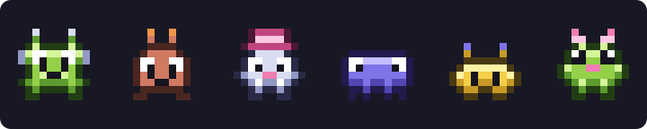
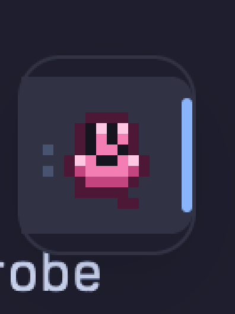

# herdr-mod-pixel-art

Pixel Party, a mod for the [Herdr](https://herdr.dev) app. Every coding agent gets a small
generated pixel creature. The creatures stand in a floating drawer at the window's edge and
move according to what their agents are doing.

- **Drawer.** One sprite per agent. On a side edge only the sprites show; hover slides out
  each agent's name and what it is doing. Click a row to go to that agent.
- **Motion.** A sprite walks while its agent works, asks for attention when the agent is
  blocked, celebrates when it finished, and rests when it is idle.
- **Hits.** When an agent adds or removes lines in its git repository, the numbers pop
  over its sprite like hits in a fighting game: green `+12` for added lines, red `−3` for
  removed ones, with a flash and a knock.
- **Worker bees.** Every helper an agent starts is a little honey bee that flies out of its
  creature and hovers beside it until the helper ends: terminals started with `hc run`
  with no setup, sub-agents with [one hook](#worker-bees).
- **Yours to choose.** Right-click a row for a grid of other creatures. The choice is saved
  as a label on the agent's terminal, so it stays through restarts and shows on every
  Herdr client.
- **No setup per agent.** An agent without a choice gets a creature generated from its
  terminal address, the same one every time.



Static examples from the sprite generator; the drawer animates them in Herdr.

## Install

Needs the Herdr app, Git, [`just`](https://just.systems), and Node.js.
The app integration was verified with Herdr 0.1.15; local tests run with Node.js
26.13.0 and CI targets Node.js 24. Herdr provides `herdr-app` and `hc`.
The commands below use a POSIX shell (macOS or Linux).

```sh
git clone https://github.com/fullerzz/herdr-mod-pixel-art.git
cd herdr-mod-pixel-art
just install   # link mods/pixel-party into ~/.config/herdr-app/mods and check it loads
just dock      # float the drawer on the right edge of the layout you are looking at
```

`just dock` edits a layout file, so it needs a layout of your own: Herdr replaces its
shipped layouts on every start. Make one with
`herdr-app do layout.clone '{"name":"main","as":"my-layout"}'`. The first dock keeps the
untouched file beside the layout as `<layout>.json.pre-pixel-party`.

```sh
just dock my-layout --edge left --align end   # another layout, edge or spot
just dock --peek off                          # always open, instead of a drawer
just undock                                   # take the drawer out again
```

Drag the drawer anywhere afterwards; Herdr remembers the spot. To put the mod in a layout
by hand instead, use a block with `"content": { "mod": "pixel-party" }`.

After changing the mod's files, run `just install` again: a linked mod reloads when the
link is remade.

## Choosing a creature

- Right-click an agent's row in the drawer and pick one. Shuffle shows other candidates.
  Reset goes back to the agent's default creature.
- From a shell, with any seed of 1 to 32 characters from `a-z`, `0-9` and `-`:

  ```sh
  hc label t7 pixel.avatar=knight7     # choose
  hc label t7 pixel.avatar=            # back to the default
  hc run --label pixel.avatar=wizard -- claude   # choose at launch
  ```

- With keys. Three commands act on the agent whose pane has the keyboard, else on
  Herdr's current agent: the row the drawer marks. Bind them in
  `~/.config/herdr-app/keys.json`, or run them with `herdr-app do`:

  | Command | What it does |
  |---|---|
  | `pixel-party.pick` | Opens the picker as a dialog |
  | `pixel-party.reroll` | Gives the agent a random creature |
  | `pixel-party.reset` | Goes back to the default creature |

  ```json
  { "global": { "ctrl-shift-y": "pixel-party.reroll" } }
  ```

## Worker bees



A bee is one running helper of the agent it hovers beside. It flies while the helper
works, blinks when the helper is blocked, and rests when the helper is idle. Past six
helpers, the last place counts the rest.

- **`hc` helpers** need no setup: every live terminal an agent started with `hc run`, and
  every one those started, is a bee, even after the terminal that started it has ended.
- **Sub-agents** run inside the agent's own program, where Herdr can't see them. A hook
  tells the mod: `tools/bee-hook.sh` keeps one `pixel.bee.<id>` label per running
  sub-agent on the agent's terminal. Install it for Claude Code and Codex with:

  ```sh
  just hooks --dry-run   # say what would change
  just hooks             # both, or `just hooks claude` / `just hooks codex`
  ```

  It adds three hooks to `~/.claude/settings.json` and `~/.codex/hooks.json` after the
  ones already there, keeps the file as it was beside it (`.bak-pixel-party-<time>`), and
  is safe to run again. It never changes a hook that is already there: if one of yours
  also runs a `bee-hook.sh`, the new hook goes after it and a note says so. A file it
  can't change without risk (comments, a duplicate key, a hard link, a link to nothing, a
  folder it can't write in) is left untouched and reported. Codex runs hooks only with `hooks = true` under
  `[features]` in its `config.toml`, and may ask you to trust the new ones.

  By hand, for Claude Code, with the path of your clone:

  ```json
  {
    "hooks": {
      "SubagentStart": [{ "hooks": [{ "type": "command", "command": "/path/to/herdr-mod-pixel-art/tools/bee-hook.sh start", "timeout": 5 }] }],
      "SubagentStop": [{ "hooks": [{ "type": "command", "command": "/path/to/herdr-mod-pixel-art/tools/bee-hook.sh stop", "timeout": 5 }] }],
      "SessionStart": [{ "hooks": [{ "type": "command", "command": "/path/to/herdr-mod-pixel-art/tools/bee-hook.sh clear", "timeout": 5 }] }]
    }
  }
  ```

  The hook does nothing outside an `hc` terminal, and gives up on an `hc` call after 2
  seconds. `clear` removes the labels a killed session left behind. It keeps the labels of
  a program still running on the same terminal (an agent's own `claude -p` starts a session
  too): the `pixel.hive` label names the program that owns them. Any other agent can do the same from its own hooks:

  ```sh
  hc label "$HC_TERMINAL_ID" pixel.bee.review-1=1    # a bee
  hc label "$HC_TERMINAL_ID" pixel.bee.review-1=     # gone
  ```

## Contributing

[GitHub](https://github.com/fullerzz/herdr-mod-pixel-art) is the public mirror;
development is maintained in Forgejo. Open
[issues](https://github.com/fullerzz/herdr-mod-pixel-art/issues) and
[pull requests](https://github.com/fullerzz/herdr-mod-pixel-art/pulls) on GitHub.
Include your Herdr version and reproduction steps for bugs, and run the checks
below for code changes.

Accepted contributions are integrated into Forgejo and then mirrored back to
GitHub. Maintainers should not merge directly into GitHub: the push mirror can
overwrite GitHub-only commits.

## Development

Use the pnpm version pinned in `package.json` (12.16.1), available through Corepack.

```sh
pnpm install     # once: TypeScript, for the type check
just typecheck   # the mod's JSDoc types: no Herdr needed
just test        # node tests: no Herdr needed
just check       # Herdr's own loader on the mod
```

The mod is plain JavaScript typed with JSDoc. `just typecheck` checks it against Herdr's
own declarations, copied into `types/` so it runs without the app; pull requests run it
and the tests in `.forgejo/workflows/check.yml` and `.github/workflows/check.yml`.
GitHub also checks pushes to `main`, including mirrored updates.

`docs/DESIGN.md` has the module contracts and the platform facts they rest on. The tests
run the mod under stand-ins for Herdr's modules (`tests/mocks/`) that refuse what the app
refuses, such as a color that is not a hex literal. `herdr-app check` renders with no
agents, so it never runs the sprite code: the tests are what cover it. After a Herdr
update, `node tools/snapshot-api.mjs` refreshes the names the stand-ins accept and the
declarations in `types/`.

## Local access

The mod runs `hc label` to save a choice. The optional bee hook runs `hc label` and
`hc get` on its own agent's terminal; `just hooks` edits Claude Code's and Codex's hook
files and keeps a backup of each. Edit tracking watches local agent
repositories, runs Git to count changes, and reads up to 50 untracked files per
scan to count their lines. The mod makes no direct network requests; Herdr and
`hc` handle connections to any configured remote machines.

The install command creates a symlink in Herdr's mod directory. The dock tool
edits your chosen layout and keeps a backup on its first change.

## License

Original project code is [MIT licensed](LICENSE). Copied Herdr API declarations
retain their upstream license; see [third-party notices](THIRD_PARTY_NOTICES.md).
