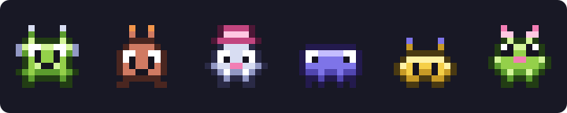
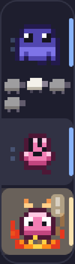
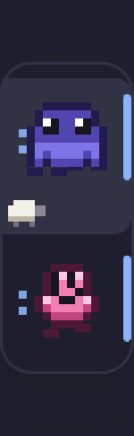
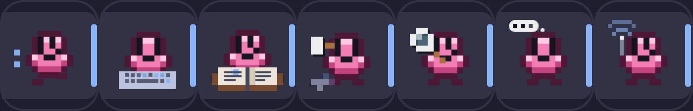
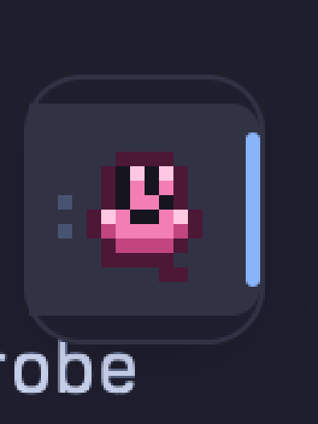
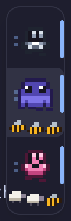

# herdr-mod-pixel-art

Pixel Party, a mod for the [Herdr](https://herdr.dev) app. Every coding agent gets a small
generated pixel creature. The creatures stand in a floating drawer at the window's edge and
move according to what their agents are doing.

- **Drawer.** One sprite per agent. On a side edge only the sprites show; hover slides out
  each agent's name and what it is doing. Click a row to go to that agent.
- **Motion.** A sprite works while its agent works, catches fire and asks for attention
  when the agent is blocked, celebrates when it finished, and rests when it is idle. When
  a blocked agent goes on, water puts its fire out before it goes back to work.
- **Ways of working.** With [one more hook](#ways-of-working), a working creature does
  what its agent does: it types while the agent edits files, reads a book while it reads,
  bubbles a test tube while it runs tests, lifts bricks with a crane while it builds,
  unpacks a box while it installs, grows a branching twig while it uses git, hammers
  while it runs other commands, sweeps a lens while it searches, holds up an antenna
  while it fetches from the web, and thinks when a prompt comes in. Without the hook,
  each creature works its own way, the same every time.
- **Hits.** When an agent adds or removes lines in its git repository, the numbers pop
  over its sprite like hits in a fighting game: green `+12` for added lines, red `−3` for
  removed ones, with a flash and a knock. The bigger the change, the harder it hits: a
  line or a few is a small tick, and 200 lines or more is a crit, with big numbers, a CRIT
  tag, a solid flash and a longer pause.
- **Stamps.** When an agent makes a git commit, a rubber stamp slams down on its creature
  and lifts away to leave a green check: a stamp of approval on finished work. The check
  holds a moment, then fades.
- **Signposts.** When an agent checks out or switches to another branch, a signpost by its
  creature flips from pointing back to pointing the other way.
- **Smoke.** With [the same hooks](#failed-commands), a command an agent runs that fails
  makes its creature cough, and a puff of black smoke goes up from its face.
- **Worker bees.** Every helper an agent starts is a little figure that flies out of its
  creature from a puff of smoke and stays beside it until the helper ends: a sheep for a
  terminal started with `hc run`, with no setup, and a honey bee for a sub-agent, with
  [one hook](#worker-bees).
- **Magic arrivals.** A new agent appears by a magic trick: a wand taps its empty spot, a
  puff of smoke and sparkles goes up, and its creature is there when the smoke clears. An
  agent that ends leaves by the same trick in reverse.
- **Yours to choose.** Right-click a row for a grid of other creatures. The choice is saved
  as a label on the agent's terminal, so it stays through restarts and shows on every
  Herdr client.
- **No setup per agent.** An agent without a choice gets a creature generated from its
  terminal address, the same one every time.



Static examples from the sprite generator; the drawer animates them in Herdr.

## Install

Needs the Herdr app, Git, [`just`](https://just.systems), and Node.js.
The app integration was verified with Herdr 0.1.15; local tests run with Node.js
26.13.0 and CI targets Node.js 24. Herdr provides `herdr-app` and `hc`.
The commands below use a POSIX shell (macOS or Linux).

```sh
git clone https://github.com/fullerzz/herdr-mod-pixel-art.git
cd herdr-mod-pixel-art
just install   # link mods/pixel-party into ~/.config/herdr-app/mods and check it loads
just dock      # float the drawer on the right edge of the layout you are looking at
```

`just dock` edits a layout file, so it needs a layout of your own: Herdr replaces its
shipped layouts on every start. Make one with
`herdr-app do layout.clone '{"name":"main","as":"my-layout"}'`. The first dock keeps the
untouched file beside the layout as `<layout>.json.pre-pixel-party`.

```sh
just dock my-layout --edge left --align end   # another layout, edge or spot
just dock --peek off                          # always open, instead of a drawer
just undock                                   # take the drawer out again
```

Drag the drawer anywhere afterwards; Herdr remembers the spot. To put the mod in a layout
by hand instead, use a block with `"content": { "mod": "pixel-party" }`.

After changing the mod's files, run `just install` again: a linked mod reloads when the
link is remade.

## Choosing a creature

- Right-click an agent's row in the drawer and pick one. Shuffle shows other candidates.
  Reset goes back to the agent's default creature.
- From a shell, with any seed of 1 to 32 characters from `a-z`, `0-9` and `-`:

  ```sh
  hc label t7 pixel.avatar=knight7     # choose
  hc label t7 pixel.avatar=            # back to the default
  hc run --label pixel.avatar=wizard -- claude   # choose at launch
  ```

- With keys. Three commands act on the agent whose pane has the keyboard, else on
  Herdr's current agent: the row the drawer marks. Bind them in
  `~/.config/herdr-app/keys.json`, or run them with `herdr-app do`:

  | Command | What it does |
  |---|---|
  | `pixel-party.pick` | Opens the picker as a dialog |
  | `pixel-party.reroll` | Gives the agent a random creature |
  | `pixel-party.reset` | Goes back to the default creature |

  ```json
  { "global": { "ctrl-shift-y": "pixel-party.reroll" } }
  ```

## Fire



An agent that is blocked, waiting on a permission prompt or a question, sets its creature
on fire. A bed of flames burns at its feet and tongues lick up its sides until the agent
goes on. The `!` badge and the tinted cell stay, in the theme's "Needs you" color.

When the agent goes back to work, the fire is put out: water drops onto the flames, they
die with a splash, and steam rises off the creature and fades. The creature holds still
for those two seconds, then goes back to work. A blocked agent that turns done or idle
instead just loses its fire.

## Stamps


A commit in an agent's repository stamps its creature, with no setup. A rubber stamp drops
onto the creature's lower right, the cell dips under the blow, and the stamp lifts away to
leave a check in the theme's "Finished" color. The check, not its color, says the work is
approved, so it never reads as the red "Needs you" cue. Each step is slow enough to follow,
and the check holds for about two seconds before it fades. A commit lands on the agents working in that
repository, or on every agent in it when none is working, the same as hits.

Any `git commit` counts, whoever runs it: `--amend`, a merge commit (also one `git merge`
makes) and the first commit of a new repository included, even one made with `git init`
where the agent already is. A checkout, reset, rebase, pull or cherry-pick moves the branch
too, but is no stamp. Commits in a linked worktree count as well, and a commit still counts
when other git commands follow it right away.

## Signposts

A `git checkout` or `git switch` in an agent's repository flips a signpost by its creature,
with no setup. The sign shows at the creature's lower left pointing back, the way the
agent came from, then its board turns and points the other way, the way it went. It holds
a moment and fades, about three seconds in all. A checkout lands on the same agents as a
commit. A checkout of the branch already checked out goes nowhere and shows nothing.

## Failed commands

When a command a Claude Code agent runs fails, its creature coughs: it lurches down a little,
and a puff of black smoke goes up from its face, drifts to the top of its cell and clears.
The whole puff takes about a second. Each failure is a puff of its own, so two in a row
are two puffs.

A failure is a shell command that ends with an exit code other than 0. A failed read or
edit is not one, nor a command the person interrupts, nor one a sub-agent runs. It needs
the hook `just hooks` installs: [`tools/bee-hook.sh fail`](#worker-bees) on Claude Code's
`PostToolUseFailure`, which Claude Code sends for exactly these. Codex has no such event,
so a Codex creature never smokes. The hook keeps a `pixel.result` label on the agent's
terminal, with a new value for each failure. Any agent can report one itself:

```sh
hc label "$HC_TERMINAL_ID" pixel.result=failed.$$   # a new value each time
```

## Magic arrivals



An agent that starts while the drawer is open arrives by a trick, with no setup. A wand
shows over its empty cell and taps it, a puff of smoke and sparkles goes up, and the smoke
clears to show the creature. Its status line says "Abracadabra!" meanwhile. The whole trick
takes about a second and a half. A new helper's figure comes out of a small puff of its
own. The agents and helpers already running when the drawer opens get no trick.

An agent that ends leaves by the trick in reverse. Its row stays where it was, and its
status line says "Poof!". The wand taps the creature, the smoke goes up, and the cell is
empty when it clears. Then the row is gone, a little over a second after the agent
ended. The row does nothing when clicked meanwhile. An agent that comes back during the
trick arrives again.

## Ways of working



The recording is older than the four ways for kinds of command: testing, building,
installing and git. A working creature shows what its agent is doing, when the agent's
hooks say:

| Way | The agent | Claude Code's tools |
|---|---|---|
| typing | edits files | Edit, MultiEdit, Write, NotebookEdit |
| reading | reads files | Read |
| testing | runs tests: `npm test`, `cargo test`, `pytest`, `node --test` | Bash |
| building | builds: `npm run build`, `cargo build`, `tsc`, `make` | Bash |
| installing | installs packages: `pnpm install`, `npm ci`, `pip install` | Bash |
| git | runs git | Bash |
| hammering | runs any other command | Bash |
| searching | searches code | Grep, Glob |
| signal | fetches from the web | WebFetch, WebSearch |
| thinking | has a new prompt to think about | none: a prompt came in |

The hook tells a command by the first program in it that it knows: `cd app && npm test`
is testing, and `git commit -m "fix build"` is git. For a tool that does many things, such
as `npm`, `cargo`, `go` or `make`, the subcommand decides, and for `npm run` the script's
name. It reads only the first 512 bytes of the tool's input, so a long script says what
its start says.

The way holds until the next tool or prompt, not only while the tool runs: a read is over
in a moment, and the creature would never be seen reading. Any other tool takes the way
away, and the creature works its own way again: one of the six before the kinds of
command, or a walk, picked by its seed. A creature without the hooks always works its own
way.

Codex reads and searches through its shell, which its hooks name `Bash`, so a Codex agent
mostly hammers; its tests, builds, installs and git show as they do for Claude Code, if
its hooks give the command as Claude Code's do, which is not yet checked. The hook also takes `apply_patch`, `shell` and `web_search` for Codex's
patches, shell and searches, names not yet checked against a running Codex. The same `just hooks` that installs the bee hooks below installs these two:
`tools/bee-hook.sh tool` before each tool and `tools/bee-hook.sh think` on each prompt.
They keep a `pixel.work` label on the agent's terminal. The hooks of a sub-agent's tools
leave it alone: a sub-agent is a bee. Any agent can say what it is doing itself:

```sh
hc label "$HC_TERMINAL_ID" pixel.work=reading   # one of the ten ways, or walk
hc label "$HC_TERMINAL_ID" pixel.work=          # its own way again
```

## Worker bees



A figure is one running helper of the agent it stays beside: a sheep for a helper Herdr
runs, a honey bee for a sub-agent. It moves while the helper works (a bee flies, a sheep
hops), blinks when the helper is blocked, and rests when the helper is idle. Past six
helpers, the last place counts the rest. The recording above is older than the sheep: it
shows `hc` helpers as bees. Now, two `hc` helpers and one sub-agent look like this:



- **`hc` helpers** are sheep, and need no setup: every live terminal an agent started with
  `hc run`, and every one those started, even after the terminal that started it has ended.
- **Sub-agents** are honey bees. They run inside the agent's own program, where Herdr can't see them. A hook
  tells the mod: `tools/bee-hook.sh` keeps one `pixel.bee.<id>` label per running
  sub-agent on the agent's terminal. Install it for Claude Code and Codex with:

  ```sh
  just hooks --dry-run   # say what would change
  just hooks             # both, or `just hooks claude` / `just hooks codex`
  ```

  It adds six hooks to `~/.claude/settings.json` and five to `~/.codex/hooks.json` (Codex
  has no event for a failed command) after the ones already there, keeps the file as it was beside it (`.bak-pixel-party-<time>`), and
  is safe to run again. It never changes a hook that is already there: if one of yours
  also runs a `bee-hook.sh` (even this one, under a matcher that limits it to some tools),
  the new hook goes after it and a note says so. A file it
  can't change without risk (comments, a duplicate key, a hard link, a link to nothing, a
  folder it can't write in) is left untouched and reported. Codex runs hooks only with `hooks = true` under
  `[features]` in its `config.toml`, and may ask you to trust the new ones.

  By hand, for Claude Code, with the path of your clone:

  ```json
  {
    "hooks": {
      "SubagentStart": [{ "hooks": [{ "type": "command", "command": "/path/to/herdr-mod-pixel-art/tools/bee-hook.sh start", "timeout": 5 }] }],
      "SubagentStop": [{ "hooks": [{ "type": "command", "command": "/path/to/herdr-mod-pixel-art/tools/bee-hook.sh stop", "timeout": 5 }] }],
      "SessionStart": [{ "hooks": [{ "type": "command", "command": "/path/to/herdr-mod-pixel-art/tools/bee-hook.sh clear", "timeout": 5 }] }],
      "PreToolUse": [{ "hooks": [{ "type": "command", "command": "/path/to/herdr-mod-pixel-art/tools/bee-hook.sh tool", "timeout": 5 }] }],
      "UserPromptSubmit": [{ "hooks": [{ "type": "command", "command": "/path/to/herdr-mod-pixel-art/tools/bee-hook.sh think", "timeout": 5 }] }],
      "PostToolUseFailure": [{ "hooks": [{ "type": "command", "command": "/path/to/herdr-mod-pixel-art/tools/bee-hook.sh fail", "timeout": 5 }] }]
    }
  }
  ```

  The hook does nothing outside an `hc` terminal, and gives up on an `hc` call after 2
  seconds. The tool hook takes about 30 ms, so each tool waits that long to start. `clear` removes
  the labels a killed session left behind, `pixel.work` and `pixel.result` too. It keeps the labels of
  a program still running on the same terminal (an agent's own `claude -p` starts a session
  too): the `pixel.hive` label names the program that owns them. Any other agent can do the same from its own hooks:

  ```sh
  hc label "$HC_TERMINAL_ID" pixel.bee.review-1=1    # a bee
  hc label "$HC_TERMINAL_ID" pixel.bee.review-1=     # gone
  ```

## Contributing

[GitHub](https://github.com/fullerzz/herdr-mod-pixel-art) is the public mirror;
development is maintained in Forgejo. Open
[issues](https://github.com/fullerzz/herdr-mod-pixel-art/issues) and
[pull requests](https://github.com/fullerzz/herdr-mod-pixel-art/pulls) on GitHub.
Include your Herdr version and reproduction steps for bugs, and run the checks
below for code changes.

Accepted contributions are integrated into Forgejo and then mirrored back to
GitHub. Maintainers should not merge directly into GitHub: the push mirror can
overwrite GitHub-only commits.

## Development

Use the pnpm version pinned in `package.json` (12.16.1), available through Corepack.

```sh
pnpm install     # once: TypeScript, for the type check
just typecheck   # the mod's JSDoc types: no Herdr needed
just test        # node tests: no Herdr needed
just check       # Herdr's own loader on the mod
```

The mod is plain JavaScript typed with JSDoc. `just typecheck` checks it against Herdr's
own declarations, copied into `types/` so it runs without the app; pull requests run it
and the tests in `.forgejo/workflows/check.yml` and `.github/workflows/check.yml`.
GitHub also checks pushes to `main`, including mirrored updates.

`docs/DESIGN.md` has the module contracts and the platform facts they rest on. The tests
run the mod under stand-ins for Herdr's modules (`tests/mocks/`) that refuse what the app
refuses, such as a color that is not a hex literal. `herdr-app check` renders with no
agents, so it never runs the sprite code: the tests are what cover it. After a Herdr
update, `node tools/snapshot-api.mjs` refreshes the names the stand-ins accept and the
declarations in `types/`.

## Local access

The mod runs `hc label` to save a choice. The optional bee hook runs `hc label` and
`hc get` on its own agent's terminal. Before a shell command it reads the command's
first 512 bytes and keeps only its kind (testing, building, installing, git or other) in
the `pixel.work` label; `just hooks` edits Claude Code's and Codex's hook
files and keeps a backup of each. Edit tracking watches local agent
repositories (and the git folder of a linked worktree), runs Git to count changes and
read HEAD's reflog for new commits and its other moves (with `tail`), and reads up to 50 untracked files per
scan to count their lines. The mod makes no direct network requests; Herdr and
`hc` handle connections to any configured remote machines.

The install command creates a symlink in Herdr's mod directory. The dock tool
edits your chosen layout and keeps a backup on its first change.

## License

Original project code is [MIT licensed](LICENSE). Copied Herdr API declarations
retain their upstream license; see [third-party notices](THIRD_PARTY_NOTICES.md).
